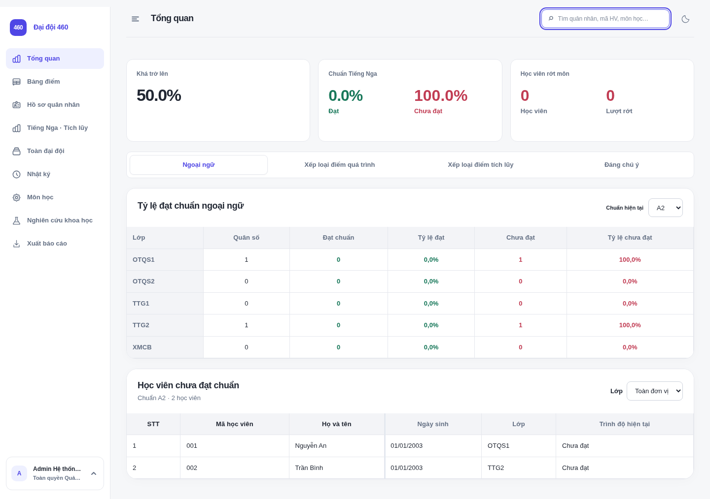
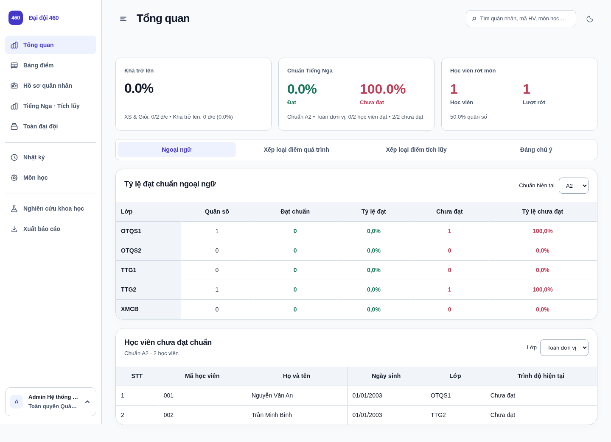
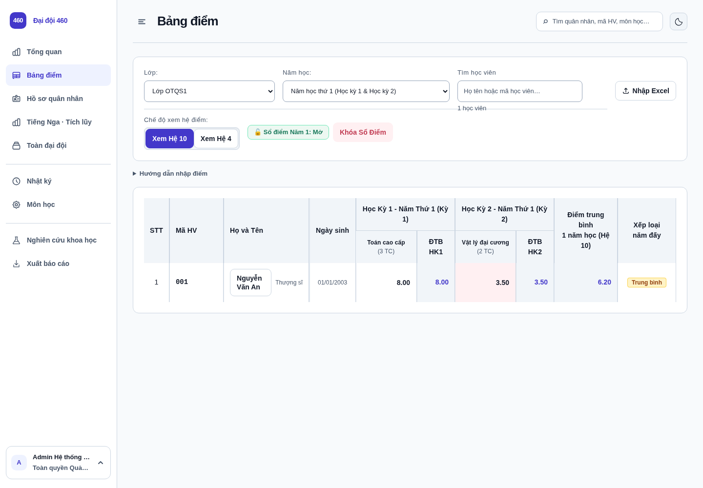
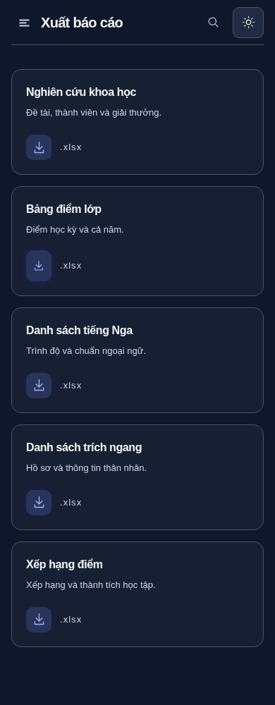
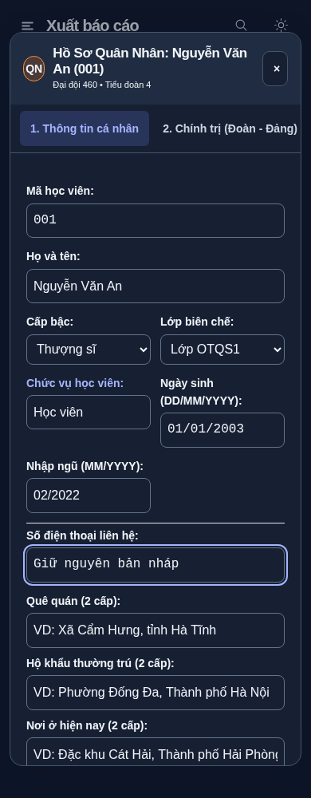

# Edu460 V2 — Bản giao diện chờ duyệt

Nhánh `design/edu460-v2`, dựa trên `05d8665`. Không merge `main`, không triển khai website chính thức. Ảnh dưới đây dùng dữ liệu giả lập, không phải hồ sơ thật.

## Xem trước

| Tổng quan trước | Tổng quan V2 |
| --- | --- |
|  |  |

| Báo cáo trên điện thoại, chế độ tối | Form hồ sơ trên điện thoại, chế độ tối |
| --- | --- |
|  |  |

## Những phần đã thực hiện

Mọi quy tắc mới nằm trong `src/css/interface.css`, không thêm thư viện hoặc lớp stylesheet mới. `index.html` chỉ cập nhật mã phiên bản tài nguyên bằng script build.

| Phần | Thay đổi trình bày | Giữ nguyên |
| --- | --- | --- |
| Design system | Nền #F8FAFC, chữ #111827 / #475569, viền #CBD5E1, nhấn #4338CA; bộ màu tối riêng; Inter; nhãn từ 13px, bảng 14px, tiêu đề 26px | Cài đặt giao diện cá nhân hiện có |
| Sidebar/header | Sidebar 240px khi mở, 76px khi thu gọn, phân đoạn nhẹ; tiêu đề rõ; tìm kiếm không chồng nút ở tablet; drawer mobile và vùng chạm lớn | Menu, quyền hiện/ẩn, tìm kiếm, bàn phím và tài khoản |
| Dashboard/thống kê | KPI đồng nhất, số tabular, bảng dùng đường ngang, khôi phục hiển thị các dòng chi tiết KPI trước đây bị CSS ẩn | Giá trị và công thức KPI, toàn bộ nội dung nghiệp vụ |
| Bảng điểm | Toolbar lọc rõ ràng, nút nhập không xuống dòng bất thường, ô điểm/focus rõ, đường cột dành riêng cho bảng điểm, bảng cuộn trong khung | ID, input, nhập điểm/bàn phím, khóa năm, GPA, xếp loại |
| Hồ sơ | Card thống kê trung tính, form tương phản, tab trong modal cuộn ngang thay vì xuống 5 dòng trên điện thoại | Trường, lưu/xóa, thân nhân, phạm vi dữ liệu và phân quyền |
| Ngoại ngữ/tích lũy/môn học | Nhãn và hàng bảng rõ, trạng thái chọn nhất quán, màu trạng thái giữ ý nghĩa | Chuẩn ngoại ngữ, môn học, bộ lọc và cách tính |
| NCKH | Hai KPI, bảng, tên liên kết và hộp sửa theo bộ token; sửa chữ tối bị hòa nền trong trang chi tiết Dark Mode | Đề tài, thành viên, giải thưởng, quyền sửa, Excel |
| Báo cáo/cài đặt | Card phẳng, tên file và mô tả dễ đọc, màu nút và tab thống nhất | Danh mục, cấu hình, tải/xuất và định dạng Excel |
| Modal/trạng thái | Bỏ blur nền, bóng nhẹ, giới hạn theo chiều cao màn hình, lỗi/focus/busy giữ rõ; không dựng lại node form | Luồng xác nhận, loading/empty/error/success và dữ liệu đang nhập |
| Chuyển động | Hover 140ms, trang/modal 180ms, sidebar 220ms, tắt pulse liên tục, hỗ trợ reduced motion | Sự kiện và xử lý ứng dụng |

## Đánh giá CSS hiện tại

Các file cấu trúc gồm `expanding-rail`, `bento-dashboard`, `workspace-reports`, `readability`, `display-settings`, `research`, `subject-catalog`, `year-breakdown`; `rose-theme` còn ánh xạ màu cho component cũ. Nhiều selector cũ trùng màu/kích thước; V2 sửa trực tiếp lớp chung cuối cùng `interface.css`, gộp các sửa lặp ở sidebar và bảng thay vì tạo thêm stylesheet. Giữ các file nền để tránh làm mất cấu trúc component.

Đã phát hiện và sửa: font nhỏ 9–12px; thông tin KPI bị ẩn; nền bán trong suốt làm mất tương phản bảng điểm học viên ở chế độ tối; chữ trang chi tiết NCKH tối trên nền tối; tên định dạng `.xlsx` quá nhạt; thanh tìm kiếm chồng nút ở tablet; tab modal hồ sơ quá hẹp trên điện thoại.

## Kiểm thử

- `npm test`: 105 bài kiểm tra đạt.
- `npm run build`: tạo bản tĩnh thành công.
- `tests/interface-browser.cjs`: đăng nhập, menu thu gọn/drawer, focus/Escape, tìm kiếm, theme, giữ node và nội dung form, reduced motion, không tràn trang.
- `tests/research-browser.cjs`: bốn vai trò, phạm vi lớp, sửa đề tài/giải thưởng, xung đột lưu, nội dung an toàn, Excel nhập/xuất.
- `tests/cadet-results-browser.cjs`: mở hồ sơ từ tên, đầy đủ năm/kỳ/môn, sửa/xóa điểm, viền môn rớt và quyền sửa.
- `tests/class-transcript-browser.cjs`: phạm vi lớp, chọn báo cáo và file Excel thực trên desktop/mobile.
- `tests/edu460-v2-browser.cjs`: bốn vai trò ở 1440/768/390px, tất cả tab được phép, Light/Dark, đối chiếu tương phản chữ thông thường ≥4.5:1 và chữ lớn ≥3:1; modal hồ sơ/NCKH, đổi theme giữ bản nháp. Đã kiểm tra 204 tổ hợp màn hình/vai trò/kích thước/chế độ màu, gồm Cài đặt truy cập từ menu tài khoản; không phát hiện vi phạm ngưỡng tương phản trong phạm vi giả lập đã kiểm tra. Mọi API được giả lập; ghi từ suite giao diện sẽ làm test thất bại.

Chạy browser test với `NODE_PATH` trỏ tới Playwright/XLSX đã cài, `UI_TEST_CSS_PATH` (hoặc `RESEARCH_TEST_CSS_PATH` / `REPORT_TEST_CSS_PATH`) trỏ tới CSS Tailwind đã biên dịch nếu môi trường không dùng CDN. Máy chủ cục bộ cổng 3000; test báo cáo dùng `TEST_BASE_URL=http://127.0.0.1:3000`.

## Giới hạn

Kiểm tra tự động bao phủ các màn hình và dữ liệu giả lập trên Chromium, không phải chứng nhận WCAG đầy đủ hay kiểm tra mọi dữ liệu thực/tổ hợp trình duyệt. Bảng nhiều cột vẫn cần cuộn ngang trên điện thoại để giữ toàn bộ chức năng. Bản nhánh chưa triển khai, vì vậy website chính thức chưa mang giao diện này.

Không sửa JavaScript nghiệp vụ, database/schema, xác thực, phân quyền, công thức điểm/GPA/xếp loại, quy trình lưu hay mã nhập/xuất Excel. Không dùng Supabase thật để thử ghi.
